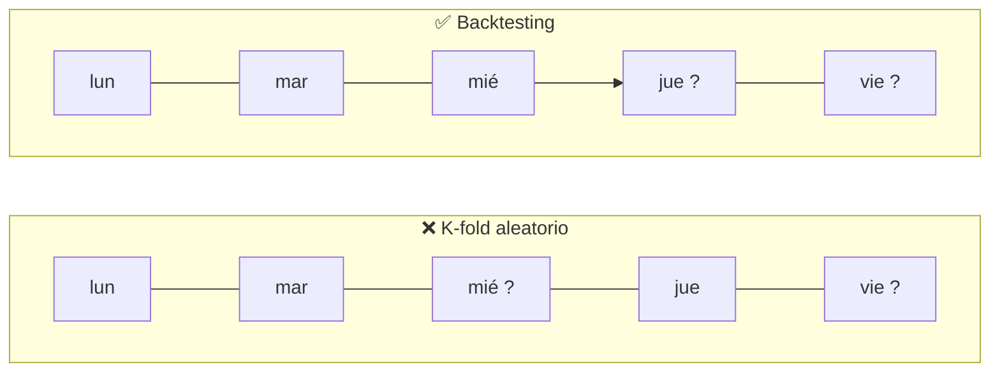
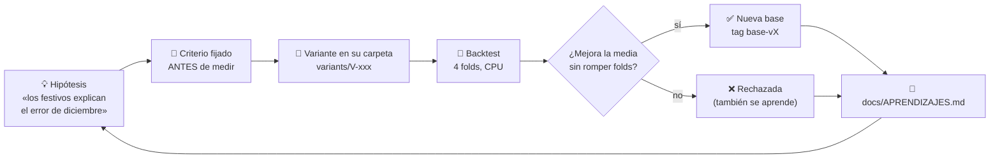
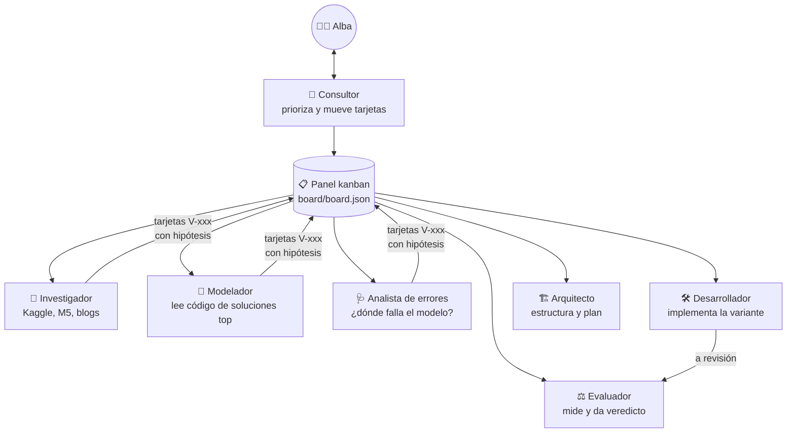

# 🛒 ¿Cuánto venderá mañana un supermercado?

**Previsión de ventas de 1.782 series temporales con validación temporal honesta**, contada paso a paso.
Lo hice para aprender *forecasting* después de Titanic y Kaggle Playground. Cada idea se trató como un experimento con
hipótesis, criterio fijado antes de medir y veredicto, y la mayor parte del trabajo lo hizo un equipo de agentes de IA
coordinado desde un tablero kanban (más abajo explico cómo).

> Competición: [Store Sales – Time Series Forecasting](https://www.kaggle.com/competitions/store-sales-time-series-forecasting) (Kaggle, *Getting Started*)
> · Métrica: **RMSLE** (cuanto más bajo, mejor) · Todo corre en **CPU, en minutos**.

| | |
|---|---|
| 🏁 **Nota en Kaggle** | **0.39720** (v0.7, la mejor) · empezó en 0.45751 (v0.1) |
| 📈 **Error en las prácticas** | **0.3838** (base-v7) · empezó en 0.4745 (base-v0) |
| 🧪 **Ideas probadas** | 21: 9 forman el modelo actual, 12 no entraron → [qué aprendí en cada una](docs/APRENDIZAJES.md) |
| 🌳 **Árbol de experimentos** | [`docs/experimentos.html`](docs/experimentos.html): cada idea explicada sin tecnicismos (descárgalo y ábrelo en el navegador) |


---

## 1. El problema en 30 segundos

[Corporación Favorita](https://www.corporacionfavorita.com/) es una gran cadena de supermercados de Ecuador. Tenemos sus ventas
diarias de **2013 a agosto de 2017**: **54 tiendas × 33 familias de productos** (pan, bebidas, limpieza…), es decir,
**1.782 series temporales**. Hay que predecir los **16 días siguientes** de cada serie.


Las pistas que da Kaggle además de las ventas:

| Archivo | Qué es | ¿Lo sabemos en el futuro? |
|---|---|---|
| `train.csv` | ventas diarias y nº de productos en promoción | promociones **sí** (se planifican antes) |
| `stores.csv` | ciudad, tipo y *cluster* de cada tienda | sí (no cambia) |
| `oil.csv` | precio del petróleo (Ecuador depende mucho de él) | sí, Kaggle lo incluye |
| `holidays_events.csv` | festivos nacionales, regionales y locales, y días trasladados | sí |
| `transactions.csv` | nº de tickets por tienda y día | **no**: solo hasta hoy |

Esa última columna importa más de lo que parece (ver [fuga de información](#3-la-trampa-mirar-el-futuro-sin-querer)).

---

## 2. ¿Qué tiene de especial una serie temporal?

En Titanic las filas son **independientes**: un pasajero no depende del anterior, así que se pueden barajar y repartir al
azar entre entrenamiento y validación. Aquí **el orden importa**: lo que se vendió ayer dice mucho de lo que se venderá mañana.

Patrones que se ven a simple vista:


- **Estacionalidad semanal:** el fin de semana se vende más.
- **Día de paga:** en Ecuador el sector público cobra el 15 y el último día del mes, y se nota.
- **Eventos:** el 1 de enero las tiendas cierran, diciembre se dispara y el **terremoto del 16 de abril de 2016** alteró las ventas durante semanas.
- **Muchos ceros:** algunas familias (libros, bebés…) apenas se venden en muchas tiendas.


---

## 3. La trampa: mirar el futuro sin querer

Si validas como en Titanic, con *k-fold* aleatorio, el modelo entrena con datos del jueves para «predecir» el miércoles
anterior. En la validación sale genial y en el test real se hunde. A eso se le llama **fuga de información** (*data leakage*):
el modelo usó información que no tendrá cuando prediga de verdad.



**La solución: backtesting** (validación temporal). Me sitúo en una fecha del pasado, entreno solo con lo anterior y predigo
los 16 días siguientes, igual que en el test de Kaggle. Lo repito en 4 fechas distintas (*folds*) para no fiarme de una sola
quincena:


- **4 folds** (azul): sirven para comparar ideas. Una idea se acepta si mejora la media **con dos semillas distintas**
  y no empeora más de un fold. Al principio exigía además que la mejora superase el «ruido» del azar (~0.001), pero esa regla
  rechazó V-014, que en Kaggle mejoró 0.0039: una mejora pequeña que se repite siempre en la misma dirección no es casualidad.
- **Fold de control** (16–31 de agosto de 2016): la misma quincena que el test de Kaggle, un año antes. No decide nada, avisa.
  Se mira **sin las tiendas que cerraron** esos días (18 y 25) ni la que aún no había abierto (52): un cierre no se puede prever.
- **Holdout** (rojo): los últimos 16 días. **No se toca** hasta el final; es el examen de verdad antes de enviar a Kaggle.
  Si mirase el holdout para decidir, acabaría ajustándome a él sin darme cuenta (otra forma de fuga, más sutil).
- El código que corta los datos ([`scripts/backtest.py`](scripts/backtest.py)) **solo le entrega al modelo el pasado**:
  la regla no depende de que me acuerde de cumplirla, está en el código. También corta `transactions` en la fecha del fold,
  porque en el test no existe.

---

## 4. La métrica: RMSLE

$$\text{RMSLE} = \sqrt{\frac{1}{n}\sum_i \big(\log(1+\hat y_i) - \log(1+y_i)\big)^2}$$

Al usar logaritmos mide **errores relativos**: predecir el doble cuesta lo mismo si vendes 10 panes que si vendes 10.000.
Así las 33 familias pesan parecido, aunque «GROCERY I» venda mil veces más que «BOOKS».


Consecuencia práctica: muchos modelos se entrenan directamente sobre `log1p(ventas)` y al final se deshace con `expm1`.

---

## 5. Cómo trabajo: cada idea es un experimento



- **La base no se toca nunca:** `models/base/` es el mejor modelo hasta hoy. Cada idea va en `variants/V-xxx/`,
  una copia con *un solo cambio*. Así, si mejora, sé exactamente por qué.
- **Comparo fold a fold y familia a familia**, no solo la media. Una mejora media puede esconder que algo se rompe en una
  familia concreta.
- **Las ideas rechazadas también cuentan:** quedan en [docs/APRENDIZAJES.md](docs/APRENDIZAJES.md), con el porqué.

### El equipo (agentes de IA con Claude Code)



Quien implementa una variante nunca la evalúa. Un *runner* ([`board/runner.py`](board/runner.py)) recoge tarjetas del panel
(cada 3 horas o con el botón **▶ Iniciar** del panel) y lanza al agente que toca, con permisos acotados: puede ejecutar Python y
leer git, pero no instalar, borrar, hacer commits ni push, ni tocar Kaggle. Lo que aprendí montándolo:

- **Ver qué hace el agente sin gastar tokens:** la CLI escribe cada paso en un log (`stream-json`) y el panel lo muestra en directo,
  con un indicador de si el proceso sigue vivo y cuándo hizo su última acción.
- **Dos carriles en paralelo:** «pensar» (investigador, modelador, analista, arquitecto) y «medir» (desarrollador, evaluador),
  para que nunca coincidan dos backtests que se pelean por la CPU. Cada carril hace commit solo de sus propios ficheros.
- **Comandos denegados a la vista:** si a un agente le bloquean un comando, queda anotado en su tarjeta; si lo bloqueado era crear
  tarjetas, la suya no puede cerrarse como hecha.
- **Tarjetas para humanos:** la descripción empieza en lenguaje llano y lo técnico va plegado debajo.
- **Los envíos los preparo yo (consultor) y los sube Alba**, revisando antes el examen final. El MCP de Kaggle solo lo usa el
  consultor, con permiso en cada envío; el runner lo tiene bloqueado.

---

## 6. Resultados

### El tronco: lo que forma el modelo actual

| Paso | Idea, en llano | Prácticas | Examen final | Kaggle |
|---|---|---|---|---|
| base-v0 | repetir la media de las dos últimas semanas | 0.4745 | 0.5191 | 0.45751 |
| V-001 | tener en cuenta el día de la semana | 0.4304 | 0.5109 | — |
| V-002 | calcular en proporciones (escala logarítmica), como mide la nota | 0.4154 | 0.5244 | 0.41457 |
| V-004 | un modelo que aprende de las 1.782 series a la vez (LightGBM) | 0.4057 | — | — |
| V-005 | darle las promociones como pista | 0.3946 | — | — |
| V-006 | recordar lo vendido hace un año | 0.3904 | 0.4378 | 0.41341 |
| V-009 | media de dos maneras de predecir: los 16 días de golpe y día a día | 0.3858 | 0.4187 | 0.40327 |
| V-014 | afinar los ajustes del LightGBM (aceptada tras el envío experimental) | 0.3852 | 0.4179 | 0.39940 |
| **V-025 + V-023** | **aprender del año anterior sin sus cierres, y predecir cero solo en series de verdad muertas** | **0.3838** | **0.4139** | **0.39720** |

### Las ramas: lo que se probó y se descartó

| Idea | Qué pasó | Por qué |
|---|---|---|
| V-003 · ajustar a mano por promociones | empeora mucho (0.4571) | la promoción coincide con otras cosas y la fórmula le atribuía efectos ajenos |
| V-007 · entrenar con pérdida tweedie | empeora (0.4094) | puntúa unidades, pero la nota mide proporciones |
| V-008 · un modelo por cada día del horizonte | empeora mucho (0.4833) | cada modelo aprende con 16 veces menos ejemplos |
| V-009 recursivo solo · predecir día a día | mejora dentro del ruido (0.3894) | solo funciona combinado con el directo (V-009) |
| V-011 · poner tope a las promociones | igual (0.3908) | en las prácticas casi no hay picos que recortar |
| V-012 · triplicar los ejemplos de entrenamiento | peor de media (0.3919), ×4 de tiempo | los ejemplos nuevos repiten información |
| V-013 · mezclar con el modelo sencillo | mejora a base-v3 pero no a base-v4 | una opinión débil resta en una media de opiniones fuertes |
| V-017 · festivos por tienda (nacional/regional/local) | media 0.3849 (−0.0003) pero empeora 2 de 4 prácticas | casi no hay festivos en las prácticas; los retardos ya los reflejan |
| V-016 · día del mes y día de paga | empeora 3 de 4 prácticas (0.3878) | el modelo ya lo deducía de las ventas recientes |
| V-019 · predecir cero en series dormidas | mejora las prácticas (0.3849) pero empeora el examen final (0.4227) | da por muerto el material escolar que arranca en agosto; se corrige en V-023 |
| V-023 · cero solo en series de verdad muertas (excepción de temporada) | prácticas 0.3849 / 0.3850 (base 0.3852), mejora 4/4 folds; examen final pendiente del consultor | no toca series que vendieron en las mismas fechas del año anterior |
| V-020 · reparto distinto de las dos opiniones según el tipo de producto | empeora 3 de 4 prácticas (0.3856 / 0.3857 vs 0.3852) | el reparto 50/50 ya era casi óptimo |
| V-018 · ejemplos de la vuelta al cole del año anterior | prácticas 0.3839 / 0.3840 (base 0.3852), mejora 4/4 folds; material escolar −0.014 | el modelo ve cómo es un arranque de temporada |
| V-018 · entrenar también con el mismo periodo del año anterior | mejora todo lo local (0.3839, examen final 0.4148) pero **empeora en Kaggle** (0.40871) | en agosto de 2016 las tiendas 18 y 25 cerraron; el modelo copió ese hundimiento al test de 2017. Limpia de cierres (V-025) sí entró |
| V-025 · año anterior sin copiar sus cierres | prácticas 0.3841 / 0.3839 (base 0.3852), mejora 4/4 folds; tiendas 18 y 25 ya no se hunden en el test | quita los cierres de 2016 de los ejemplos del año anterior |
| V-027 · promociones de los días vecinos y de las 2 semanas siguientes | prácticas 0.3829 / 0.3829 (base-v7 0.3838 / 0.3836), mejora 4/4 folds; tarda 78 s → 130 s | una promoción mueve las compras de los días de alrededor |
| V-028 · nivel reciente de la tienda entera y de la familia en todo el país (rechazada) | prácticas 0.3845 / 0.3848 (base-v7 0.3838 / 0.3836), peor en 3/4 folds; tarda 78 s → 205 s | el nivel de la tienda y de la familia ayudaría a series ruidosas |
| V-020 · repartir distinto las dos formas de predecir según el producto | igual o peor (0.3856) | el reparto a medias ya era el bueno |
| V-021 · media de varias copias del modelo (repesca de V-010) | empata (0.3851) y tarda 4 veces más | más copias del mismo modelo no aportan información |
| V-022 · decirle qué series se venden a ratos (repesca de V-015) | mejora un poco las prácticas (0.3850) pero empeora el examen final (0.4204) | no compensa |

Los números exactos de cada experimento (por fold, por familia y por semilla) están en [docs/APRENDIZAJES.md](docs/APRENDIZAJES.md)
y en `eval/results/`. En curso: festivos por tienda (V-017).

---

## 7. Cómo reproducirlo

```bash
python -m venv .venv && .venv\Scripts\activate
python -m pip install -r requirements.txt
kaggle competitions download -c store-sales-time-series-forecasting -p data   # y descomprimir en data/
python scripts/backtest.py --src models/base --name base-v0                    # ~1 min en CPU
python scripts/results.py compare base-v0 V-001                                # variante contra base
python scripts/make_figures.py                                                 # regenera docs/img/
python scripts/make_submission.py --src models/base --name base-v0            # → dist/, para subir a Kaggle
python -m pytest tests -q
```

```
models/base/        el mejor modelo hasta hoy (model.py: fit_predict(history, future, ctx))
variants/V-xxx/     un experimento = una copia de la base + un cambio + NOTAS.md
eval/folds.json     los 4 folds del backtest (fijos)   · eval/holdout.json  el examen final (intocable)
eval/results/       resultados por experimento (RMSLE por fold y familia)
scripts/            backtest, comparación, figuras, envío
board/              panel kanban + runner de agentes   · .claude/agents/  definición de cada agente
docs/               APRENDIZAJES.md (bitácora), análisis de errores, diseño de modelos
```

---

## 8. Qué he aprendido

1. **Lo sencillo primero.** Fijarse en el día de la semana bajó el error más que todo lo demás junto.
2. **Mide como te van a medir.** Calcular en proporciones (V-002) mejoró; entrenar con otra vara (V-007) empeoró.
3. **Un examen solo engaña; tres que coinciden, no.** v0.3 mejoraba en las prácticas y apenas en Kaggle. Desde v0.4, cuando
   prácticas, examen final y control bajan a la vez, Kaggle también baja.
4. **Una mejora pequeña y repetida no es ruido.** V-014 se rechazó por mejorar «solo» 0.0005 y en Kaggle mejoró 0.0039.
5. **Las reglas duras son peligrosas con productos de temporada.** Poner a cero lo que lleva dos meses sin venderse (V-019) mataba
   el material escolar justo antes de la vuelta al cole; solo lo vio el examen final.
6. **Lo que copias del pasado incluye sus accidentes.** Entrenar con el mismo periodo del año anterior (V-018) mejoraba en todas
   las medidas locales y empeoró en Kaggle: en esas fechas de 2016 dos tiendas estuvieron cerradas, y el modelo lo trasladó a 2017.
   Ninguna medida local cubría esa quincena con esas tiendas abiertas. Limpiando esos cierres (v0.7), la misma idea dio la mejor nota.
7. **Rechazar también es avanzar.** Doce ideas no entraron en el modelo, y cada una dejó escrito por qué.

La bitácora completa, con un glosario de cada concepto nuevo, está en [docs/APRENDIZAJES.md](docs/APRENDIZAJES.md).
