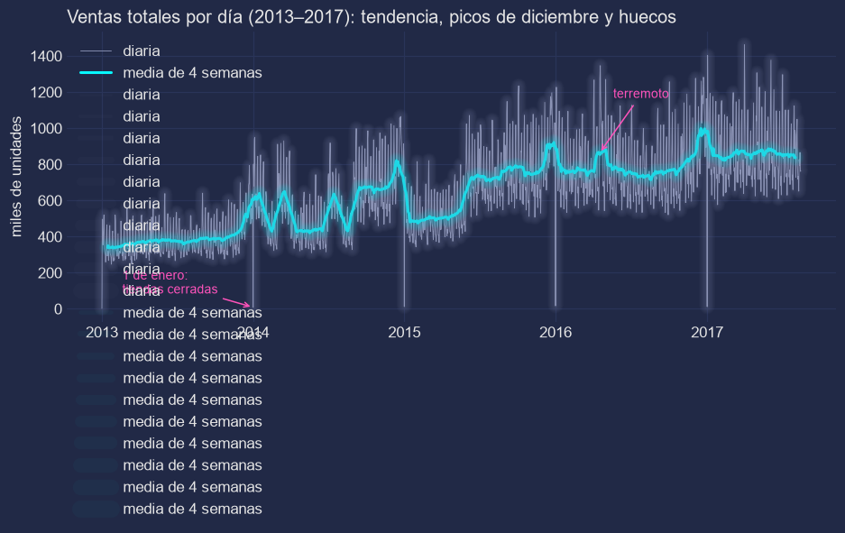
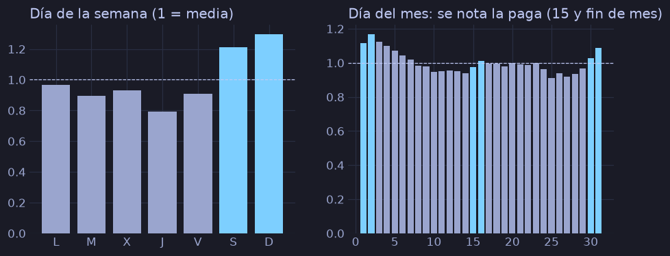
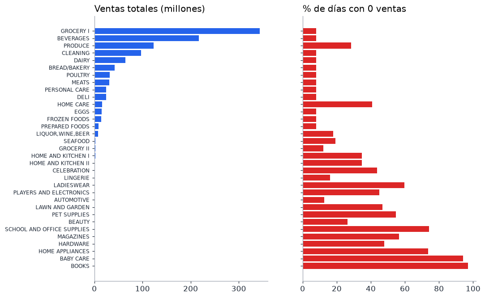
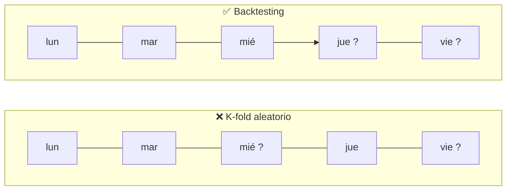
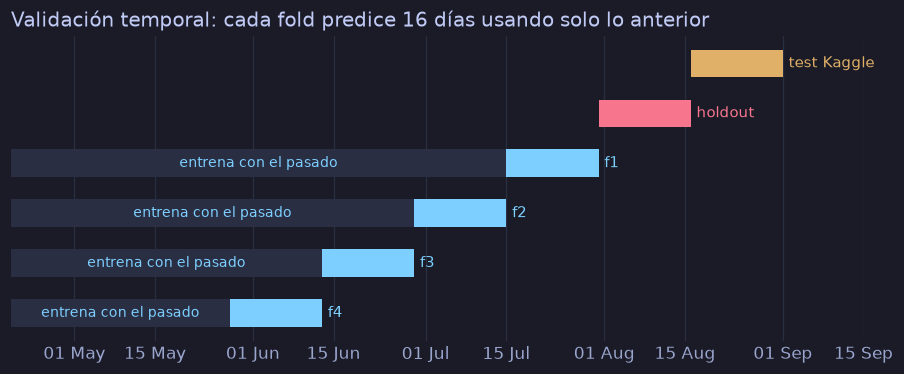
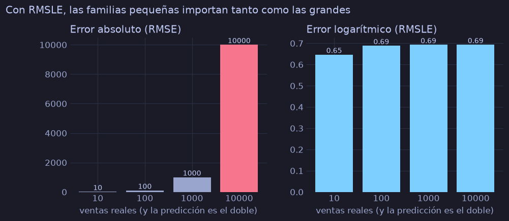
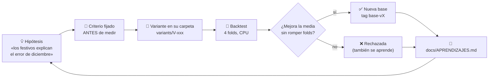
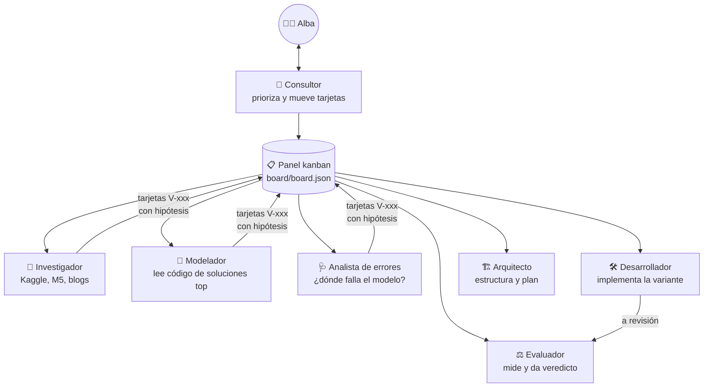
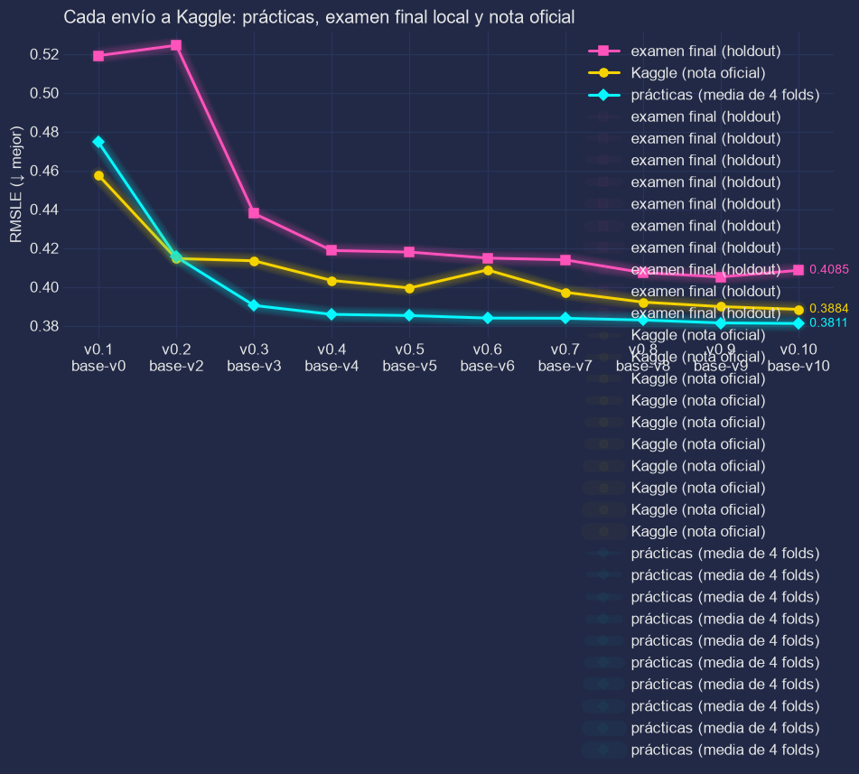

# 🛒 ¿Cuánto venderá mañana un supermercado?

**Previsión de ventas de 1.782 series temporales con validación temporal honesta**, contada paso a paso.
Lo hice para aprender *forecasting* después de Titanic y Kaggle Playground. Cada idea se trató como un experimento con
hipótesis, criterio fijado antes de medir y veredicto, y la mayor parte del trabajo lo hizo un equipo de agentes de IA
coordinado desde un tablero kanban (más abajo explico cómo).

> Competición: [Store Sales – Time Series Forecasting](https://www.kaggle.com/competitions/store-sales-time-series-forecasting) (Kaggle, *Getting Started*)
> · Métrica: **RMSLE** (cuanto más bajo, mejor) · Todo corre en **CPU, en minutos**.

| | |
|---|---|
| 📈 **Mejor RMSLE en el backtest** | 0.3858 (base-v4 = V-009, media directo+recursivo) · base-v3: 0.3904 · base-v0: 0.4745 |
| 🧪 **Experimentos cerrados** | 6 aceptados · 5 rechazados → [qué aprendí en cada uno](docs/APRENDIZAJES.md) |
| 🏁 **Leaderboard de Kaggle** | 0.40327 (v0.4, base-v4) · v0.3: 0.41341 · v0.2: 0.41457 · v0.1: 0.45751 |

---

## 1. El problema en 30 segundos

[Corporación Favorita](https://www.corporacionfavorita.com/) es una gran cadena de supermercados de Ecuador. Tenemos sus ventas
diarias de **2013 a agosto de 2017**: **54 tiendas × 33 familias de productos** (pan, bebidas, limpieza…), es decir,
**1.782 series temporales**. Hay que predecir los **16 días siguientes** de cada serie.



Las pistas que da Kaggle además de las ventas:

| Archivo | Qué es | ¿Lo sabemos en el futuro? |
|---|---|---|
| `train.csv` | ventas diarias y nº de productos en promoción | promociones **sí** (se planifican antes) |
| `stores.csv` | ciudad, tipo y *cluster* de cada tienda | sí (no cambia) |
| `oil.csv` | precio del petróleo (Ecuador depende mucho de él) | sí, Kaggle lo incluye |
| `holidays_events.csv` | festivos nacionales, regionales y locales, y días trasladados | sí |
| `transactions.csv` | nº de tickets por tienda y día | **no**: solo hasta hoy |

Esa última columna importa más de lo que parece (ver [fuga de información](#3-la-trampa-mirar-el-futuro-sin-querer)).

---

## 2. ¿Qué tiene de especial una serie temporal?

En Titanic las filas son **independientes**: un pasajero no depende del anterior, así que se pueden barajar y repartir al
azar entre entrenamiento y validación. Aquí **el orden importa**: lo que se vendió ayer dice mucho de lo que se venderá mañana.

Patrones que se ven a simple vista:



- **Estacionalidad semanal:** el fin de semana se vende más.
- **Día de paga:** en Ecuador el sector público cobra el 15 y el último día del mes, y se nota.
- **Eventos:** el 1 de enero las tiendas cierran, diciembre se dispara y el **terremoto del 16 de abril de 2016** alteró las ventas durante semanas.
- **Muchos ceros:** algunas familias (libros, bebés…) apenas se venden en muchas tiendas.



---

## 3. La trampa: mirar el futuro sin querer

Si validas como en Titanic, con *k-fold* aleatorio, el modelo entrena con datos del jueves para «predecir» el miércoles
anterior. En la validación sale genial y en el test real se hunde. A eso se le llama **fuga de información** (*data leakage*):
el modelo usó información que no tendrá cuando prediga de verdad.



**La solución: backtesting** (validación temporal). Me sitúo en una fecha del pasado, entreno solo con lo anterior y predigo
los 16 días siguientes, igual que en el test de Kaggle. Lo repito en 4 fechas distintas (*folds*) para no fiarme de una sola
quincena:



- **4 folds** (azul): sirven para comparar ideas. Una idea se acepta si mejora la media **y** no empeora más de un fold.
- **Holdout** (rojo): los últimos 16 días. **No se toca** hasta el final; es el examen de verdad antes de enviar a Kaggle.
  Si mirase el holdout para decidir, acabaría ajustándome a él sin darme cuenta (otra forma de fuga, más sutil).
- El código que corta los datos ([`scripts/backtest.py`](scripts/backtest.py)) **solo le entrega al modelo el pasado**:
  la regla no depende de que me acuerde de cumplirla, está en el código. También corta `transactions` en la fecha del fold,
  porque en el test no existe.

---

## 4. La métrica: RMSLE

$$\text{RMSLE} = \sqrt{\frac{1}{n}\sum_i \big(\log(1+\hat y_i) - \log(1+y_i)\big)^2}$$

Al usar logaritmos mide **errores relativos**: predecir el doble cuesta lo mismo si vendes 10 panes que si vendes 10.000.
Así las 33 familias pesan parecido, aunque «GROCERY I» venda mil veces más que «BOOKS».



Consecuencia práctica: muchos modelos se entrenan directamente sobre `log1p(ventas)` y al final se deshace con `expm1`.

---

## 5. Cómo trabajo: cada idea es un experimento



- **La base no se toca nunca:** `models/base/` es el mejor modelo hasta hoy. Cada idea va en `variants/V-xxx/`,
  una copia con *un solo cambio*. Así, si mejora, sé exactamente por qué.
- **Comparo fold a fold y familia a familia**, no solo la media. Una mejora media puede esconder que algo se rompe en una
  familia concreta.
- **Las ideas rechazadas también cuentan:** quedan en [docs/APRENDIZAJES.md](docs/APRENDIZAJES.md), con el porqué.

### El equipo (agentes de IA con Claude Code)



Quien implementa una variante nunca la evalúa. Un *runner* ([`board/runner.py`](board/runner.py)) recoge tarjetas del panel cada
3 horas y lanza al agente que toca, con permisos acotados: puede ejecutar Python y leer git, pero no instalar, borrar,
hacer push ni enviar nada a Kaggle. Los envíos los hago yo a mano.

---

## 6. Resultados

Backtest de 4 folds (RMSLE medio ± desviación; menor es mejor). La tabla se actualiza con cada experimento cerrado.

| Variante | Idea | RMSLE backtest | Folds que mejora | Veredicto |
|---|---|---|---|---|
| base-v0 | media de los últimos 14 días por tienda×familia | 0.4745 ± 0.0090 (f1 0.4738 · f2 0.4611 · f3 0.4769 · f4 0.4864) | — | línea base |
| V-001 | base-v0 × factor del día de la semana (8 sem.) por tienda×familia | 0.4304 ± 0.0106 (f1 0.4368 · f2 0.4143 · f3 0.4283 · f4 0.4423) | −0.044 | ✅ ACEPTADA |
| V-002 | media y perfil semanal en escala log (log1p 14 d + perfil log 8 sem.) | 0.4154 ± 0.0064 (f1 0.4201 · f2 0.4057 · f3 0.4138 · f4 0.4222) | −0.015 vs base-v1 | ✅ ACEPTADA |
| V-003 | ajuste en log por promociones (beta por familia) sobre V-002 | 0.4571 ± 0.0244 (f1 0.4311 · f2 0.4405 · f3 0.4625 · f4 0.4945) | +0.042 vs base-v2 (0/4) | ❌ RECHAZADA |
| V-004 | LightGBM global (8 cortes; medias log + perfil semanal) | 0.4057 ± 0.0122 (f1 0.4041 · f2 0.3926 · f3 0.4007 · f4 0.4255) | −0.010 vs base-v2 (3/4) | ✅ ACEPTADA |
| V-005 | V-004 + 3 rasgos de promoción (día, suma 14 d, ratio) | 0.3946 ± 0.0072 (f1 0.3949 · f2 0.3860 · f3 0.3918 · f4 0.4057) | −0.011 vs V-004 (4/4) | ✅ ACEPTADA |
| V-006 | V-005 + 3 rasgos anuales (retardo 364: día, ventana ±3 d, diferencia) | 0.3904 ± 0.0087 (f1 0.3932 · f2 0.3796 · f3 0.3861 · f4 0.4029) | −0.004 vs V-005 (4/4) | ✅ ACEPTADA |
| V-007 | base-v3 con objetivo tweedie (p=1.3) sobre ventas crudas | 0.4094 ± 0.0149 (f1 0.4075 · f2 0.3885 · f3 0.4113 · f4 0.4304) | +0.019 vs base-v3 (0/4) | ❌ RECHAZADA |
| V-008 | base-v3 con 16 modelos directos (uno por horizonte h) | 0.4833 ± 0.0155 (f1 0.4793 · f2 0.4636 · f3 0.4835 · f4 0.5068) | +0.093 vs base-v3 (0/4) | ❌ RECHAZADA |
| V-009 | base-v3 + modelo recursivo (1 paso); media en log con el directo | media 0.3860 ± 0.0077 (f1 0.3912 · f2 0.3754 · f3 0.3822 · f4 0.3952); s1 0.3856. Solo recursivo: 0.3894 | −0.0045 vs base-v3 (4/4) media; recursivo solo −0.0010 (3/4) | ✅ ACEPTADA (media) · ❌ recursivo solo |
| V-011 | base-v3 con promo_day/promo_ratio recortados al p99 por familia | 0.3908 ± 0.0088 (f1 0.3953 · f2 0.3792 · f3 0.3863 · f4 0.4023) | +0.0003 vs base-v3 (2/4); 16-ago aún ×2.8–3.1 el 17-ago | ❌ RECHAZADA |
| V-012 | base-v3 con 24 cortes (en vez de 8) y peso exponencial a lo reciente (vida media 120 d) | 0.3919 ± 0.0116 (f1 0.3922 · f2 0.3751 · f3 0.3924 · f4 0.4079); s1 0.3928 | +0.0015 vs base-v3 (2/4); control ago-2016 mejora (0.7596 vs 0.7696); 4× más lento | ❌ RECHAZADA |



---

## 7. Cómo reproducirlo

```bash
python -m venv .venv && .venv\Scripts\activate
python -m pip install -r requirements.txt
kaggle competitions download -c store-sales-time-series-forecasting -p data   # y descomprimir en data/
python scripts/backtest.py --src models/base --name base-v0                    # ~1 min en CPU
python scripts/results.py compare base-v0 V-001                                # variante contra base
python scripts/make_figures.py                                                 # regenera docs/img/
python scripts/make_submission.py --src models/base --name base-v0            # → dist/, para subir a Kaggle
python -m pytest tests -q
```

```
models/base/        el mejor modelo hasta hoy (model.py: fit_predict(history, future, ctx))
variants/V-xxx/     un experimento = una copia de la base + un cambio + NOTAS.md
eval/folds.json     los 4 folds del backtest (fijos)   · eval/holdout.json  el examen final (intocable)
eval/results/       resultados por experimento (RMSLE por fold y familia)
scripts/            backtest, comparación, figuras, envío
board/              panel kanban + runner de agentes   · .claude/agents/  definición de cada agente
docs/               APRENDIZAJES.md (bitácora), análisis de errores, diseño de modelos
```

---

## 8. Qué he aprendido

La bitácora completa está en [docs/APRENDIZAJES.md](docs/APRENDIZAJES.md), con un glosario de cada concepto nuevo.
Los tres aprendizajes más importantes se resumirán aquí al terminar el proyecto.
