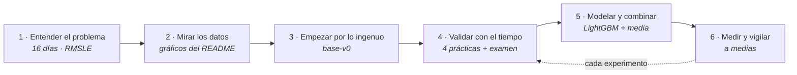
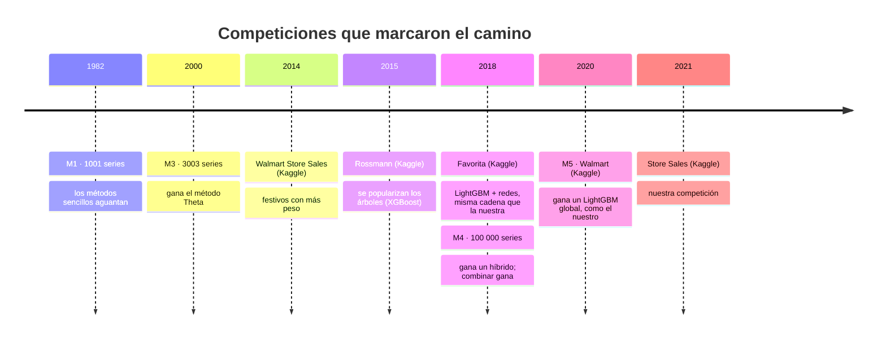
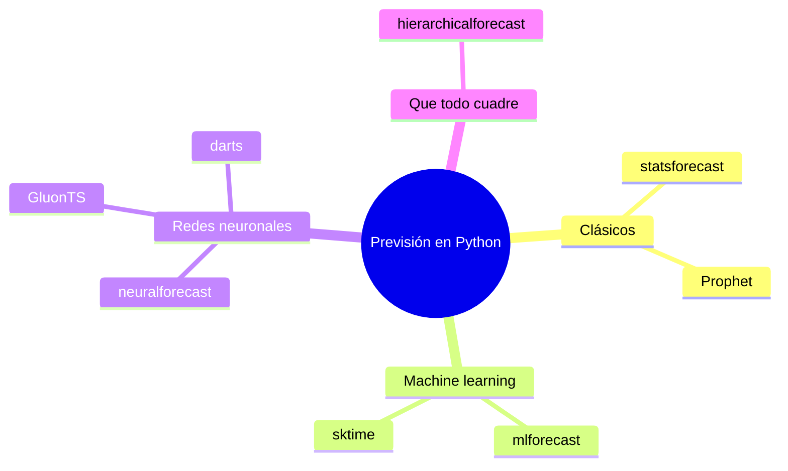
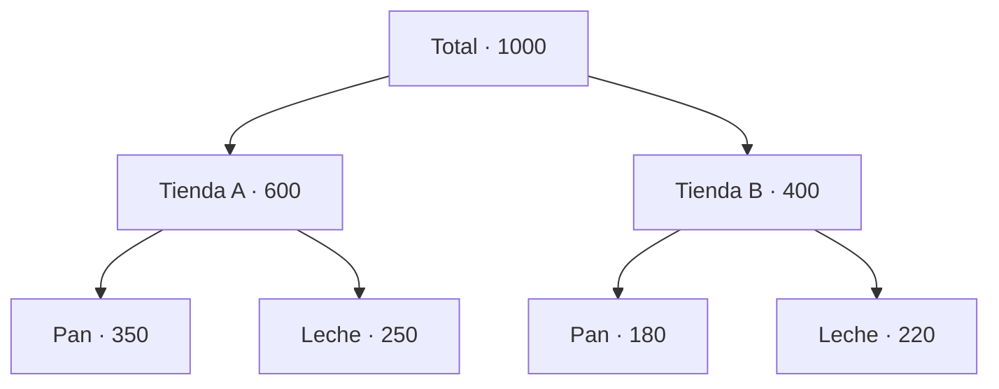

# Para saber más: cómo se aborda la previsión de ventas

Predecir ventas es uno de los problemas más estudiados de la ciencia de datos. Este documento reúne los libros, artículos,
competiciones y librerías de referencia, la forma estándar de trabajar y en qué punto está este proyecto.
Versión gráfica: [`mapa-forecasting.html`](mapa-forecasting.html) (descárgala y ábrela en el navegador).
Todos los enlaces se comprobaron el 18 de octubre de 2026.

## La forma estándar de trabajar

No hay una norma oficial tipo ISO, pero el libro de referencia y las competiciones M describen el mismo recorrido:

## Nuestra tarjeta de notas

| | Práctica estándar | En este proyecto |
|---|---|---|
| ✅ | Empezar por un modelo ingenuo y exigir ganarle | base-v0: la media de las dos últimas semanas |
| ✅ | Validar con el tiempo, nunca al azar (*rolling origin*) | 4 prácticas de 16 días, examen final guardado y control del año anterior |
| ✅ | Medir con la métrica que importa | RMSLE, entrenando en su misma escala (V-002) |
| ✅ | Modelo global y combinación de modelos | LightGBM global + media de directo y recursivo (V-009) |
| ✅ | Limpiar anomalías antes de aprender de ellas | Aprendido en v0.6: los cierres de 2016 viajaban al test |
| 〰️ | Comparar con el ingenuo con una métrica sin escala (MASE) | Lo hacemos con la RMSLE; no calculamos la MASE |
| ⬜ | Previsión probabilística (intervalos) | Pendiente: **V-033** |
| ⬜ | Reconciliación jerárquica | Pendiente: **V-034** |

## Cuarenta años de competiciones

- [Corporación Favorita Grocery Sales Forecasting](https://www.kaggle.com/competitions/favorita-grocery-sales-forecasting) · [M5 Accuracy](https://www.kaggle.com/competitions/m5-forecasting-accuracy) · [M5 Uncertainty](https://www.kaggle.com/competitions/m5-forecasting-uncertainty) (intervalos)
- [Rossmann Store Sales](https://www.kaggle.com/competitions/rossmann-store-sales) · [Walmart Store Sales](https://www.kaggle.com/competitions/walmart-recruiting-store-sales-forecasting) · [Web Traffic](https://www.kaggle.com/competitions/web-traffic-time-series-forecasting)

## Libros

| Nivel | Libro | Por qué |
|---|---|---|
| Empieza aquí | [Forecasting: Principles and Practice](https://otexts.com/fpp3/), Hyndman y Athanasopoulos (gratis, R) | El libro de referencia: todo el flujo con ejemplos |
| Empieza aquí | [FPP, the Pythonic Way](https://otexts.com/fpppy/) (gratis, Python con Nixtla) | El mismo libro en el lenguaje de este proyecto |
| Empresa | [Demand Forecasting Best Practices](https://www.manning.com/books/demand-forecasting-best-practices), Nicolas Vandeput (Manning) | Cómo se organiza la previsión de demanda en una compañía |
| Empresa | [Business Forecasting](https://www.wiley.com/en-us/Business+Forecasting%3A+Practical+Problems+and+Solutions-p-9781119224563), Gilliland, Tashman y Sglavo (Wiley) | El «valor añadido de la previsión»: ¿cada paso mejora al ingenuo? |
| Avanzado | [Modern Time Series Forecasting with Python](https://www.packtpub.com/en-us/product/modern-time-series-forecasting-with-python-9781835883181), Manu Joseph (Packt) | Modelos globales con árboles y redes, nuestro terreno actual |

## Artículos que se citan siempre

| Año | Artículo | Qué explica |
|---|---|---|
| 2000 | [Out-of-sample tests of forecasting accuracy](https://doi.org/10.1016/S0169-2070(00)00065-0), Tashman | Por qué validar con el pasado y medir en el futuro (nuestro backtesting) |
| 2006 | [Another look at measures of forecast accuracy](https://doi.org/10.1016/j.ijforecast.2006.03.001), Hyndman y Koehler | Qué métrica usar; propone la MASE |
| 2020 | [The M4 Competition](https://doi.org/10.1016/j.ijforecast.2019.04.014), Makridakis et al. | Las combinaciones ganan a los métodos solos |
| 2022 | [M5 accuracy competition](https://doi.org/10.1016/j.ijforecast.2021.11.013), Makridakis et al. | Por qué ganó LightGBM en ventas de supermercado |
| 2022 | [Forecasting: theory and practice](https://arxiv.org/abs/2012.03854), Petropoulos et al. (gratis) | Enciclopedia del campo, para consultar |

También: [DeepAR](https://arxiv.org/abs/1704.04110) (previsión probabilística de Amazon) y [MinT](https://robjhyndman.com/papers/mint.pdf) (reconciliación jerárquica).

## Librerías

[statsforecast](https://github.com/Nixtla/statsforecast) · [mlforecast](https://github.com/Nixtla/mlforecast) · [neuralforecast](https://github.com/Nixtla/neuralforecast) · [hierarchicalforecast](https://github.com/Nixtla/hierarchicalforecast) · [darts](https://github.com/unit8co/darts) · [sktime](https://github.com/sktime/sktime) · [GluonTS](https://github.com/awslabs/gluonts) · [Prophet](https://github.com/facebook/prophet)

## Lo que nos falta, explicado

**Intervalos (V-033).** Hoy damos un número por día. Una previsión probabilística da además una banda («entre 80 y 130 unidades
con un 90 % de confianza»), que es lo que una tienda necesita para decidir el stock de seguridad.

**Reconciliación jerárquica (V-034).** Predecimos cada tienda×familia por separado y nada obliga a que sumen lo que
predeciríamos para la tienda o el país. Reconciliar ajusta todos los niveles a la vez para que cuadren.

## Comunidad

[International Institute of Forecasters](https://forecasters.org/) (edita el *International Journal of Forecasting*) ·
[Institute of Business Forecasting](https://ibf.org/) (certificación para empresa). En empresa, la previsión forma parte del
proceso S&OP (planificación de ventas y operaciones).
